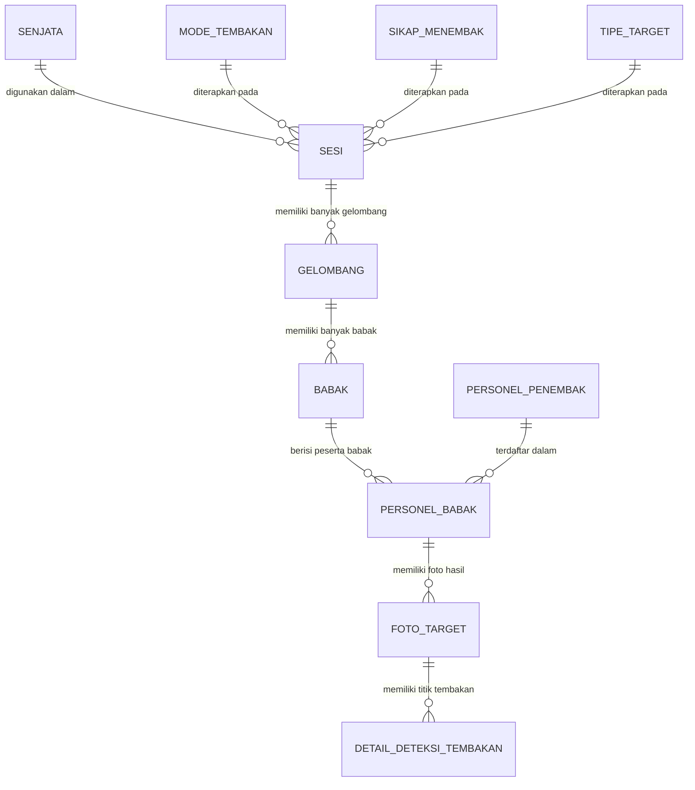

# SITRAK Back-End API

Backend RESTful API untuk sistem **SITRAK** (*Sistem Informasi & Tracking Latihan Menembak*). Repositori ini bertindak sebagai server utama untuk mengelola atribut master (senjata, mode tembakan, sikap menembak, tipe target), data personel penembak, manajemen hierarki sesi menembak (sesi &rarr; gelombang &rarr; babak &rarr; personel babak), serta penerimaan dan penyimpanan data deteksi tembakan dari modul computer vision (*SITRAK-Detect*).

---

## 🛠️ Tech Stack & Dependencies

- **Runtime Environment:** Node.js (v18+)
- **Framework:** Express.js (`^4.18.2`)
- **Database:** PostgreSQL (Driver `pg ^8.11.3`)
- **Keamanan & Utilitas:**
  - `cors`: Cross-Origin Resource Sharing
  - `dotenv`: Pengelolaan environment variables
  - `jsonwebtoken`: Autentikasi berbasis JWT
  - `bcryptjs`: Hashing password/kredensial
  - `express-validator`: Validasi skema request
- **Development Tool:** `nodemon` untuk hot-reloading

---

## 📁 Struktur Direktori Project

```text
sitrak-backend/
├── controller/
│   ├── index.js              # Entrypoint ekspor controller
│   └── userController.js     # Request handler untuk atribut, personel, sesi, & deteksi tembakan
├── db.config/
│   └── db.config.js          # Konfigurasi koneksi database PostgreSQL (node-postgres Client)
├── middleware/
│   └── auth.js               # Middleware verifikasi token JWT
├── router/
│   ├── index.js              # Entrypoint router
│   └── router.js             # Definisi rute endpoint API
├── services/
│   ├── index.js              # Entrypoint ekspor services
│   └── service.js            # Business logic, kalkulasi scoring, dan query database PostgreSQL
├── validators/
│   ├── index.js              # Entrypoint validator
│   ├── validation.js         # Aturan express-validator
│   └── validator.js          # Middleware pengecekan hasil validasi
├── .env                      # Konfigurasi environment lokal (PORT, DB credentials, Secret)
├── package.json              # Konfigurasi dependensi dan scripts npm
├── server.js                 # Entrypoint server Express dan inisialisasi koneksi DB
└── README.md                 # Dokumentasi project
```

---

## ⚙️ Konfigurasi Environment (`.env`)

Buat atau sesuaikan file `.env` di root direktori project:

```env
# Application
PORT=1200

# Database PostgreSQL
DB_USER=postgres
DB_HOST=localhost
DB_DATABASE=db_sitrak
DB_PASSWORD=postgres
DB_PORT=5432

# Token & Keamanan
SECRET=your_jwt_secret_key_here
```

---

## 🚀 Panduan Menjalankan Project

### 1. Instalasi Dependensi
```bash
npm install
```

### 2. Menjalankan Server (Mode Development)
```bash
npm run devStart
```
Server akan berjalan secara otomatis di port yang ditentukan di `.env` (default: `http://localhost:1200`).

### 3. Menjalankan Server (Mode Production)
```bash
node server.js
```

---

## 🗄️ Struktur Database & Entitas Utama

Sistem SITRAK menggunakan relasi hierarkis untuk setiap kegiatan latihan menembak:



1. **Atribut Master:**
   - `jenis_senjata`: Kategori senjata (cth: Senapan Serbu, Pistol).
   - `senjata`: Model senjata spesifik, kaliber, pabrikan.
   - `mode_tembakan`: Mode tembak (Tunggal / Otomatis / Tigaan).
   - `sikap_menembak`: Sikap menembak (Tiup / Duduk / Berdiri).
   - `tipe_target`: Jenis target (Bullseye, Siluet L1, Siluet Setengah Badan, Plat Baja).
2. **Master Personel:**
   - `personel_penembak`: NRP, nama, pangkat, satuan.
3. **Hierarki Sesi Latihan:**
   - `sesi`: Sesi kegiatan menembak (nama sesi, tempat, tanggal, jumlah lajur, status).
   - `gelombang`: Pembagian lajur/kloter menembak per sesi.
   - `babak`: Tahapan menembak pada gelombang terkait (nama babak, jumlah alokasi peluru).
   - `personel_babak`: Personel yang menembak di babak terkait beserta akumulasi total skor dan persentase akurasi.
4. **Hasil Deteksi Tembakan (*SITRAK-Detect*):**
   - `foto_target`: URL foto asli, foto teranotasi, grouping radius (mm), offset bias (x, y), total peluru terdeteksi.
   - `detail_deteksi_tembakan`: Titik koordinat lubang peluru (x, y), jarak dari pusat (mm), ring zona, poin skor (1-10), dan nilai confidence model.

---

## 📡 Daftar Endpoint API

### 1. Atribut & Master Data
| Method | Endpoint | Deskripsi |
| :--- | :--- | :--- |
| `GET` | `/atribut` | Mengambil seluruh opsi atribut master (jenis senjata, mode tembakan, sikap menembak, tipe target, model senjata). |
| `GET` | `/personel` | Mengambil daftar personel penembak dengan pagination (`?page=1&limit=10&search=keyword`). |

### 2. Manajemen Sesi Menembak
| Method | Endpoint | Deskripsi |
| :--- | :--- | :--- |
| `GET` | `/sesi` | Mengambil daftar sesi dengan pagination & filter status (`?page=1&limit=10&search=&status=`). |
| `GET` | `/sesi/:id` atau `/sesi/detail?id=:id` | Mengambil data sesi secara lengkap dan hierarkis (sesi &rarr; gelombang &rarr; babak &rarr; personel babak & foto target). |
| `POST` | `/sesi` | Membuat sesi baru sekaligus gelombang, babak, dan memetakan personel penembak ke babak terkait. |
| `PATCH` / `PUT` | `/sesi/:id/status` | Memperbarui status sesi (misal: `'Menunggu'`, `'Berlangsung'`, `'Selesai'`). |

#### Contoh Payload `POST /sesi` (Hierarkis Lengkap):
```json
{
  "nama_sesi": "Latihan Menembak Senapan Triwulan IV",
  "nama_tempat_menembak": "Lapangan Tembak 100M",
  "tanggal": "2026-10-22",
  "jumlah_jalur": 5,
  "total_gelombang": 2,
  "jarak_meter": 100,
  "id_senjata": 1,
  "id_mode_tembakan": 1,
  "id_sikap_menembak": 1,
  "id_tipe_target": 1,
  "status": "Menunggu",
  "gelombang": [
    {
      "nomor_gelombang": 1,
      "lane": 5,
      "personel": [1, 2, 3],
      "babak": [
        {
          "nomor_babak": 1,
          "nama_babak": "Babak Koreksi",
          "jumlah_peluru": 5
        },
        {
          "nomor_babak": 2,
          "nama_babak": "Babak Penilaian",
          "jumlah_peluru": 10
        }
      ]
    }
  ]
}
```

### 3. Integrasi Hasil Deteksi Tembakan (*SITRAK-Detect*)
Endpoint untuk menerima data hasil inferensi model Computer Vision (YOLO/OpenCV) dari modul pendeteksi kamera target.

| Method | Endpoint | Deskripsi |
| :--- | :--- | :--- |
| `POST` | `/deteksi` / `/tembakan` | Menyimpan hasil analisis tembakan ke `foto_target` dan `detail_deteksi_tembakan`, serta memperbarui skor akumulasi di `personel_babak`. |
| `POST` | `/sesi/:id/deteksi` | Menyimpan hasil deteksi dengan ID sesi di URL. |
| `POST` / `PUT` | `/personel-babak/:id/deteksi` | Menyimpan atau memperbarui hasil deteksi spesifik untuk ID personel babak tertentu. |

#### Contoh Payload `POST /deteksi`:
```json
{
  "id_sesi": 1,
  "id_personel_penembak": 3,
  "id_babak": 2,
  "total_skor": 85.00,
  "akurasi_persen": 85.00,
  "url_foto_asli": "/storage/raw_target_101.jpg",
  "url_foto_teranotasi": "/storage/annotated_target_101.jpg",
  "total_peluru_terdeteksi": 10,
  "grouping_radius_mm": 42.50,
  "center_offset_x_mm": -3.20,
  "center_offset_y_mm": 5.10,
  "kategori_kelulusan": "Baik Sekali",
  "status_analisis": "Selesai",
  "shots": [
    {
      "nomor_tembakan": 1,
      "koordinat_x": 450.5,
      "koordinat_y": 512.0,
      "jarak_dari_pusat_mm": 12.3,
      "skor_poin": 10,
      "ring_zona": 10,
      "confidence_score": 0.94
    },
    {
      "nomor_tembakan": 2,
      "koordinat_x": 465.0,
      "koordinat_y": 490.2,
      "jarak_dari_pusat_mm": 25.1,
      "skor_poin": 9,
      "ring_zona": 9,
      "confidence_score": 0.91
    }
  ]
}
```

---

## 🔒 Konvensi Respon API

Setiap respon API menggunakan format standar JSON:

- **Sukses (200 / 201):**
  Mengembalikan data objek atau array hasil query beserta meta pagination (untuk data tabular).
- **Client Error (400 / 404):**
  Mengembalikan pesan deskriptif alasan kegagalan request.
- **Server Error (500):**
  Mengembalikan string atau objek informasi `"Gangguan server"`.

