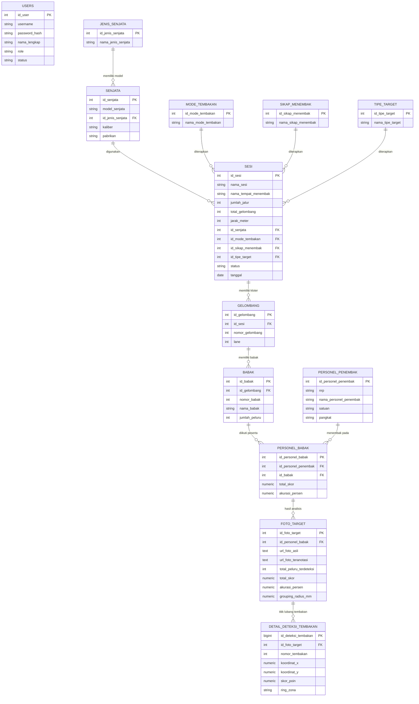

# SITRAK Back-End RESTful API

Backend RESTful API untuk sistem **SITRAK** (*Sistem Informasi & Tracking Latihan Menembak*). Repositori ini berfungsi sebagai server sentral untuk mengelola autentikasi berbasis peran (Role-Based JWT), data master dan atribut latihan menembak, hierarki sesi latihan (*Sesi &rarr; Gelombang &rarr; Babak &rarr; Personel Babak*), serta penampungan dan kalkulasi skor hasil inferensi Computer Vision (*SITRAK-Detect*).

---

## 📑 Daftar Isi
1. [Tech Stack & Dependencies](#-tech-stack--dependencies)
2. [Fitur Utama](#-fitur-utama)
3. [Struktur Direktori Project](#-struktur-direktori-project)
4. [Prasyarat Sistem](#-prasyarat-sistem)
5. [Panduan Instalasi di Device Baru](#-panduan-instalasi-di-device-baru)
6. [Konfigurasi Environment (.env)](#-konfigurasi-environment-env)
7. [Struktur & Skema Database](#-struktur--skema-database)
8. [Dokumentasi Endpoint API](#-dokumentasi-endpoint-api)
9. [Format Logging Terminal](#-format-logging-terminal)
10. [Troubleshooting & FAQ](#-troubleshooting--faq)

---

## 🛠️ Tech Stack & Dependencies

- **Runtime Environment:** Node.js (v18.x atau v20.x LTS direkomendasikan)
- **Framework Web:** Express.js (`^4.18.2`)
- **Database Engine:** PostgreSQL (v14+ dengan driver `pg ^8.11.3`)
- **Keamanan & Autentikasi:**
  - `jsonwebtoken` (`^9.0.2`): Autentikasi stateless berbasis token JWT (Bearer Token).
  - `bcryptjs` (`^2.4.3`): Hashing password dan verifikasi kredensial pengguna.
  - `cors` (`^2.8.5`): Konfigurasi Cross-Origin Resource Sharing untuk integrasi Web Frontend.
  - `express-validator` (`^6.14.2`): Validasi skema request body dan parameter.
- **Konfigurasi & Utilitas:**
  - `dotenv` (`^16.3.1`): Manajemen konfigurasi environment variables lokal.
  - Custom HTTP Logger: Middleware pencatatan log akses bergaya Uvicorn/FastAPI dengan status code ANSI color.
- **Development Tool:**
  - `nodemon` (`^3.0.2`): Auto-restart server saat terjadi perubahan kode.

---

## ✨ Fitur Utama

1. **Autentikasi & Manajemen Akun (PostgreSQL-backed):**
   - Multi-role: `administrator`, `operator`, dan `pelatih`.
   - Token JWT dengan masa kedaluwarsa 24 jam.
   - Manajemen pengguna lengkap: Tambah akun, ubah role/profil, daftar pengguna, dan hapus akun.
   - Auto-creation tabel `users` saat server pertama kali memproses request autentikasi.

2. **Master Data & Atribut Latihan:**
   - CRUD Master Personel Penembak (NRP, Nama, Satuan, Pangkat) serta bulk import data personel.
   - CRUD Master Senjata, Jenis Senjata, Mode Tembakan, Sikap Menembak, dan Tipe Target.
   - Endpoint terpusat `GET /atribut` untuk konsumsi cepat form pembuatan latihan di Frontend.

3. **Hierarki Sesi Latihan Menembak Dinamis:**
   - Pembuatan struktur latihan hierarkis dalam satu request payload:
     $$\text{Sesi} \longrightarrow \text{Gelombang (Kloter/Lane)} \longrightarrow \text{Babak} \longrightarrow \text{Personel Babak}$$
   - Pemantauan status sesi latihan (`Menunggu`, `Berlangsung`, `Selesai`).
   - Rekapitulasi detail hierarkis sesi beserta target foto dan akumulasi skor per penembak.

4. **Integrasi Computer Vision (*SITRAK-Detect*):**
   - Menerima hasil deteksi lubang peluru (koordinat $X, Y$, ring zona, jarak dari pusat dalam mm, confidence score).
   - Menyimpan metrik analisis balistik: *grouping radius* (mm), *center offset bias* ($X, Y$), akurasi persentase, dan kategori kelulusan.
   - Menyimpan referensi URL foto target asli dan foto beranotasi hasil deteksi.

5. **Terminal HTTP Access Logger:**
   - Logging setiap request HTTP yang masuk ke terminal dengan format persis server FastAPI/Uvicorn, menampilkan IP client, port, method, URL, HTTP version, status code, serta pewarnaan terminal berbasis status respon (2xx Hijau, 3xx Biru, 4xx Kuning, 5xx Merah).

---

## 📁 Struktur Direktori Project

```text
sitrak-backend/
├── controller/
│   ├── index.js                  # Export agregasi seluruh controller
│   └── userController.js         # Handler request (Auth, Atribut, Sesi, Deteksi)
├── db.config/
│   ├── db.config.js              # Inisialisasi koneksi node-postgres Client
│   └── schema.sql                # DDL skema database & data awal (seed)
├── middleware/
│   ├── auth.js                   # Middleware verifikasi token JWT & proteksi role
│   └── logger.js                 # Middleware access logger terminal (FastAPI/Uvicorn style)
├── router/
│   ├── index.js                  # Entrypoint router modular
│   └── router.js                 # Definisi seluruh rute endpoint API
├── services/
│   ├── index.js                  # Export agregasi services
│   └── service.js                # Core business logic, query PostgreSQL, kalkulasi skor
├── validators/
│   ├── index.js                  # Export validasi
│   ├── validation.js             # Aturan skema express-validator
│   └── validator.js              # Middleware penangkap error validasi
├── .env                          # File variabel environment lokal (jangan di-commit)
├── .env.example                  # Template acuan konfigurasi environment
├── package.json                  # Konfigurasi dependensi dan script npm
├── server.js                     # Entrypoint utama server Express
└── README.md                     # Dokumentasi komprehensif sistem
```

---

## 💻 Prasyarat Sistem

Sebelum memasang di perangkat (laptop/server/PC) baru, pastikan perangkat telah terpasang:

| Komponen | Versi Minimal | Fungsi |
| :--- | :--- | :--- |
| **Node.js** | `v18.0.0` atau `v20.x` (LTS) | Runtime JavaScript |
| **npm** | `v9.0.0` atau lebih baru | Package manager Node.js |
| **PostgreSQL** | `v14.0` atau lebih baru | Database Relasional |
| **pgAdmin / DBeaver** | Versi terbaru | (Opsional) GUI manajemen database |

---

## 🚀 Panduan Instalasi di Device Baru

Ikuti langkah-langkah berikut untuk memasang dan menjalankan project ini di komputer/server baru:

### Langkah 1: Siapkan Folder Project
Salin folder project `sitrak-backend` ke komputer baru, atau jika menggunakan Git:
```bash
git clone <URL_REPOSITORY_ANDA> sitrak-backend
cd sitrak-backend
```

---

### Langkah 2: Instalasi Dependensi Node.js
Buka terminal / PowerShell di dalam direktori `sitrak-backend`, lalu jalankan:
```bash
npm install
```
> Perintah ini akan mengunduh seluruh package yang tercatat di `package.json` ke folder `node_modules`.

---

### Langkah 3: Konfigurasi Database PostgreSQL

1. **Jalankan Service PostgreSQL:**
   Pastikan PostgreSQL server di komputer baru sudah berjalan (default port: `5432`).

2. **Buat Database Baru:**
   Buka tool PostgreSQL (melalui **pgAdmin 4**, **DBeaver**, atau terminal **psql**) dan buat database bernama `db_sitrak`:
   ```sql
   CREATE DATABASE db_sitrak;
   ```

3. **Eksekusi Skema & Data Awal (Seed Data):**
   Eksekusi file [`db.config/schema.sql`](file:///d:/Sus%20AI/Projects/sitrak-backend/db.config/schema.sql) ke dalam database `db_sitrak`.

   *Menggunakan psql (Command Line):*
   ```bash
   psql -U postgres -d db_sitrak -f db.config/schema.sql
   ```
   *Atau Menggunakan pgAdmin / DBeaver:*
   - Buka database `db_sitrak`.
   - Buka menu **Query Tool**.
   - Buka file `db.config/schema.sql`, salin isinya, lalu klik tombol **Execute / Run (F5)**.

> [!NOTE]
> File `schema.sql` sudah mencakup pembuatan seluruh tabel relasional, foreign key, serta seed data awal:
> - Jenis Senjata (Senapan Serbu, Pistol, dll)
> - Mode Tembakan (Tunggal, Otomatis, Tiga Butir)
> - Sikap Menembak (Tiarap, Duduk, Berlutut, Berdiri)
> - Tipe Target (Bullseye, Siluet L1, dll)
> - Akun Admin bawaan: username `admin`, password `AdminMenkor1.`

---

### Langkah 4: Konfigurasi File Environment (`.env`)

1. Salin template `.env.example` menjadi `.env`:
   - **Linux / macOS:**
     ```bash
     cp .env.example .env
     ```
   - **Windows (PowerShell):**
     ```powershell
     Copy-Item .env.example .env
     ```
   - **Windows (CMD):**
     ```cmd
     copy .env.example .env
     ```

2. Buka file `.env` menggunakan teks editor (VS Code, Notepad, dll) dan sesuaikan kredensial PostgreSQL komputer Anda:
   ```env
   # Port Server Express
   PORT=1200

   # Kredensial Database PostgreSQL Komputer Baru
   DB_USER=postgres
   DB_HOST=localhost
   DB_DATABASE=db_sitrak
   DB_PASSWORD=password_postgres_komputer_anda
   DB_PORT=5432

   # Secret Key JWT Token
   SECRET=b787c88246a8fc9d82cf87e99ebf5721d3d5c8ca2640d44610c99c836d122822fd713c6b81a628be1fba768d28ca3e3b302a23c3d7437903557928cfdf71236a
   ```

---

### Langkah 5: Menjalankan Server

#### A. Mode Development (Hot-Reloading):
Gunakan perintah ini saat proses development:
```bash
npm run devStart
```
Server akan dijalankan menggunakan `nodemon`, sehingga setiap perubahan kode akan otomatis me-reload aplikasi.

#### B. Mode Production:
Gunakan perintah ini untuk deployment atau pengujian stabil:
```bash
node server.js
```

Jika berhasil, terminal akan menampilkan output:
```text
Database Connected
Application is running on 1200!! 
```

---

### Langkah 6: Pengujian & Verifikasi Instalasi

1. Buka browser atau Postman, akses:
   ```text
   GET http://localhost:1200/
   ```
   Respon yang diharapkan:
   ```text
   Welcome Page
   ```

2. Tes Login Menggunakan Kredensial Bawaan:
   - **Method:** `POST`
   - **URL:** `http://localhost:1200/auth/login`
   - **Body (JSON):**
     ```json
     {
       "username": "admin",
       "password": "AdminMenkor1."
     }
     ```
   - Jika berhasil, Anda akan menerima objek user dan `access_token` JWT.

---

## 🗄️ Struktur & Skema Database

SITRAK menggunakan PostgreSQL dengan relasi referensial foreign key untuk menjamin integritas data latihan:



---

## 📡 Dokumentasi Endpoint API

Semua request yang membutuhkan token wajib menyertakan header:
```http
Authorization: Bearer <access_token>
Content-Type: application/json
```

### 1. Autentikasi & Akun Pengguna
| Method | Endpoint | Auth | Deskripsi |
| :--- | :--- | :---: | :--- |
| `POST` | `/auth/login` (atau `/login`) | Publik | Login pengguna menggunakan username dan password. |
| `GET` | `/auth/me` (atau `/me`) | Bearer | Mendapatkan informasi profil pengguna yang sedang login. |
| `GET` | `/users` (atau `/auth/users`) | Publik | Mengambil seluruh daftar pengguna terdaftar. |
| `POST` | `/users` (atau `/auth/users`, `/auth/register`) | Publik | Menambahkan akun pengguna baru. |
| `PUT` / `PATCH` | `/users/:id` | Publik | Memperbarui profil, role, atau kata sandi pengguna. |
| `DELETE` | `/users/:id` (atau `/auth/users/:id`) | Publik | Menghapus akun pengguna dari database. |

#### Payload `POST /auth/login`:
```json
{
  "username": "admin",
  "password": "AdminMenkor1."
}
```

#### Contoh Response `POST /auth/login`:
```json
{
  "status": "success",
  "message": "Login berhasil",
  "access_token": "eyJhbGciOiJIUzI1NiIsInR5cCI6IkpXVCJ9...",
  "user": {
    "id_user": 1,
    "username": "admin",
    "nama_lengkap": "Administrator Sistem Menkor",
    "pangkat": "Mayor",
    "nrp": "11223344",
    "jabatan": "Administrator Utama",
    "satuan": "Kodiklat TNI AL",
    "role": "administrator",
    "status": "Aktif",
    "last_login": "2026-11-08T14:30:00.000Z"
  }
}
```

---

### 2. Atribut & Master Data
| Method | Endpoint | Deskripsi |
| :--- | :--- | :--- |
| `GET` | `/atribut` | Mengambil seluruh list jenis senjata, mode tembakan, sikap menembak, tipe target, dan model senjata. |
| `GET` | `/personel` | Mengambil daftar personel penembak (`?page=1&limit=10&search=keyword`). |
| `POST` | `/personel` | Menambahkan satu data personel penembak baru (`nrp`, `nama`, `satuan`, `pangkat`). |
| `POST` | `/personel/bulk` (atau `/personel/import`) | Menambahkan banyak data personel sekaligus via array JSON. |
| `DELETE` | `/personel/:id` | Menghapus data personel penembak. |
| `POST` | `/senjata` (atau `/atribut/senjata`) | Menambahkan model senjata baru (`model_senjata`, `id_jenis_senjata`, `kaliber`, `pabrikan`). |
| `DELETE` | `/senjata/:id` | Menghapus data senjata. |
| `POST` | `/jenis-senjata` (atau `/atribut/jenis-senjata`) | Menambahkan jenis senjata baru (`nama_jenis_senjata`). |
| `DELETE` | `/jenis-senjata/:id` | Menghapus jenis senjata. |
| `POST` | `/tipe-target` (atau `/atribut/tipe-target`) | Menambahkan tipe target baru (`nama_tipe_target`). |
| `DELETE` | `/tipe-target/:id` | Menghapus tipe target. |
| `POST` | `/mode-tembakan` (atau `/atribut/mode-tembakan`) | Menambahkan mode tembakan baru (`nama_mode_tembakan`). |
| `DELETE` | `/mode-tembakan/:id` | Menghapus mode tembakan. |
| `POST` | `/sikap-menembak` (atau `/atribut/sikap-menembak`) | Menambahkan sikap menembak baru (`nama_sikap_menembak`). |
| `DELETE` | `/sikap-menembak/:id` | Menghapus sikap menembak. |

---

### 3. Manajemen Sesi Menembak
| Method | Endpoint | Deskripsi |
| :--- | :--- | :--- |
| `GET` | `/sesi` | Mengambil daftar sesi (`?page=1&limit=10&search=&status=`). |
| `GET` | `/sesi/:id` (atau `/sesi/detail?id=:id`) | Mengambil data sesi detail hierarkis (sesi &rarr; gelombang &rarr; babak &rarr; personel babak & foto target). |
| `POST` | `/sesi` | Membuat sesi latihan baru beserta gelombang, babak, dan mapping personel babak. |
| `PATCH` / `PUT` | `/sesi/:id/status` | Memperbarui status sesi (`'Menunggu'`, `'Berlangsung'`, `'Selesai'`). |

#### Contoh Payload Hierarkis Lengkap `POST /sesi`:
```json
{
  "nama_sesi": "Latihan Menembak Senapan SS2 Triwulan IV",
  "nama_tempat_menembak": "Lapangan Tembak 100M",
  "tanggal": "2026-11-08",
  "jumlah_jalur": 5,
  "total_gelombang": 1,
  "jarak_meter": 100,
  "id_senjata": 1,
  "id_mode_tembakan": 1,
  "id_sikap_menembak": 1,
  "id_tipe_target": 1,
  "status": "Menunggu",
  "gelombang": [
    {
      "nomor_gelombang": 1,
      "lane": 5,
      "personel": [1, 2, 3],
      "babak": [
        {
          "nomor_babak": 1,
          "nama_babak": "Babak Pengelompokan",
          "jumlah_peluru": 5
        },
        {
          "nomor_babak": 2,
          "nama_babak": "Babak Penilaian",
          "jumlah_peluru": 10
        }
      ]
    }
  ]
}
```

---

### 4. Integrasi Deteksi Tembakan (*SITRAK-Detect*)
Endpoint yang dipanggil oleh modul pendeteksi kamera target (Computer Vision / Python / Edge device) setelah menganalisis lubang peluru pada kertas sasaran:

| Method | Endpoint | Deskripsi |
| :--- | :--- | :--- |
| `POST` | `/deteksi` (atau `/tembakan`) | Menyimpan hasil analisis tembakan ke `foto_target` dan rincian ke `detail_deteksi_tembakan`. |
| `POST` | `/sesi/:id/deteksi` | Menyimpan hasil deteksi dengan ID sesi di parameter URL. |
| `POST` / `PUT` | `/personel-babak/:id/deteksi` | Menyimpan atau memperbarui hasil deteksi spesifik untuk entitas `id_personel_babak`. |

#### Contoh Payload `POST /deteksi`:
```json
{
  "id_sesi": 1,
  "id_personel_penembak": 1,
  "id_babak": 2,
  "total_skor": 92.00,
  "akurasi_persen": 92.00,
  "url_foto_asli": "/storage/raw_target_gel1_bbk2_p1.jpg",
  "url_foto_teranotasi": "/storage/annotated_target_gel1_bbk2_p1.jpg",
  "total_peluru_terdeteksi": 10,
  "grouping_radius_mm": 38.25,
  "center_offset_x_mm": -1.45,
  "center_offset_y_mm": 2.80,
  "kategori_kelulusan": "Istimewa",
  "status_analisis": "Selesai",
  "shots": [
    {
      "nomor_tembakan": 1,
      "koordinat_x": 512.4,
      "koordinat_y": 508.1,
      "jarak_dari_pusat_mm": 8.5,
      "skor_poin": 10,
      "ring_zona": "10",
      "confidence_score": 0.965
    },
    {
      "nomor_tembakan": 2,
      "koordinat_x": 525.0,
      "koordinat_y": 492.3,
      "jarak_dari_pusat_mm": 18.2,
      "skor_poin": 9,
      "ring_zona": "9",
      "confidence_score": 0.942
    }
  ]
}
```

---

## 📟 Format Logging Terminal

Backend dilengkapi dengan middleware logging otomatis (`middleware/logger.js`) yang memformat log terminal menyerupai server **Uvicorn / FastAPI**:

```text
INFO:     127.0.0.1:55437 - "POST /auth/login HTTP/1.1" 200 OK
INFO:     127.0.0.1:55438 - "GET /atribut HTTP/1.1" 200 OK
INFO:     172.16.8.240:60096 - "POST /deteksi HTTP/1.1" 201 Created
INFO:     172.16.8.240:64021 - "GET /sesi/detail?id=1 HTTP/1.1" 200 OK
```

- Tag `INFO:` diberi warna **Hijau**.
- Respon status `2xx` diberi warna **Hijau**.
- Respon status `3xx` diberi warna **Cyan**.
- Respon status `4xx` diberi warna **Kuning**.
- Respon status `5xx` diberi warna **Merah**.

---

## ❓ Troubleshooting & FAQ

### 1. `Error: connect ECONNREFUSED 127.0.0.1:5432`
- **Penyebab:** Service PostgreSQL belum aktif atau port PostgreSQL berbeda.
- **Solusi:**
  - Pastikan service PostgreSQL sudah berjalan (Buka Services di Windows &rarr; cari `postgresql-x64-xx` &rarr; klik Start).
  - Pastikan nilai `DB_PORT` dan `DB_PASSWORD` di file `.env` sesuai dengan konfigurasi PostgreSQL Anda.

### 2. `password authentication failed for user "postgres"`
- **Penyebab:** Password pada variabel `DB_PASSWORD` di file `.env` salah.
- **Solusi:** Periksa kembali password user `postgres` yang Anda buat saat instalasi PostgreSQL di komputer tersebut, lalu perbarui nilai `DB_PASSWORD` di `.env`.

### 3. `relation "sesi" does not exist` atau tabel tidak ditemukan
- **Penyebab:** Skema DDL database belum diimpor ke dalam database `db_sitrak`.
- **Solusi:** Eksekusi file `db.config/schema.sql` ke dalam database `db_sitrak` melalui pgAdmin Query Tool atau perintah `psql`.

### 4. `EADDRINUSE: address already in use :::1200`
- **Penyebab:** Port `1200` sedang digunakan oleh proses lain.
- **Solusi:** Ganti nilai `PORT` di file `.env` (misalnya menjadi `PORT=1201` atau `PORT=3000`).

---

## 📜 Lisensi & Kontributor
- **Lisensi:** ISC
- **Pengembang:** Tim Pengembang SITRAK (*Sistem Informasi & Tracking Latihan Menembak*)
